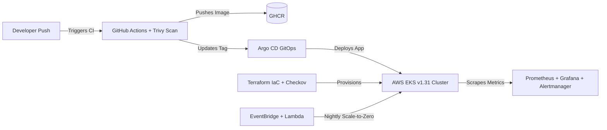

# Hi, I'm Veeresh Shetter 👋

**DevOps & Cloud Engineer** focused on Kubernetes, Terraform Infrastructure as Code, GitOps CI/CD, DevSecOps automation, and Prometheus/Grafana observability.

---

### End-to-End DevOps Portfolio Architecture

---

### Featured Production-Grade Projects

| Project | Stack & Engineering Highlights | Live Proof & Code |
| :--- | :--- | :--- |
| **1. Secure GitOps CI/CD Pipeline** | Non-root Go microservice (`~12 MB` Alpine), automated unit tests, **Trivy** `CRITICAL`/`HIGH` CVE gate, GHCR, and **Argo CD** self-healing sync. | [`gitops-app`](https://github.com/Veeresh-Shetter/gitops-app) |
| **2. AWS EKS Infrastructure & FinOps** | Modular **Terraform** IaC (`VPC`, private **Amazon EKS v1.31**, remote S3/DynamoDB state), **Checkov** IaC security CI, and **EventBridge + Lambda** nightly auto-scaler. | [`aws-eks-terraform-iac`](https://github.com/Veeresh-Shetter/aws-eks-terraform-iac) • [AWS Screenshots](https://github.com/Veeresh-Shetter/aws-eks-terraform-iac) |
| **3. Kubernetes Observability Stack** | Helm-managed **Prometheus**, **Grafana**, and **Alertmanager** (`kube-prometheus-stack`) with cross-namespace discovery and custom **PromQL `PrometheusRule`** alerts. | [`k8s-prometheus-grafana-observability`](https://github.com/Veeresh-Shetter/k8s-prometheus-grafana-observability) • [Grafana Dashboards](https://github.com/Veeresh-Shetter/k8s-prometheus-grafana-observability) |

---

### Core Technical Skills

* **Cloud & Infrastructure as Code:** AWS (VPC, EKS, IAM, Lambda, EventBridge, S3, DynamoDB), Terraform (Modular IaC, Remote State Locking)
* **Containers & Orchestration:** Kubernetes, Helm, Docker (Multi-Stage Builds, Non-Root Hardening)
* **CI/CD & GitOps:** GitHub Actions, Argo CD (Declarative Sync, Automated Pruning & Self-Healing)
* **Security & FinOps:** Trivy Container Scanning, Checkov Static IaC Analysis, Serverless Cost Optimization
* **Observability & SRE:** Prometheus, Grafana, Alertmanager, PromQL, `kube-state-metrics`
* **Languages & Scripting:** Go, Python, Bash, YAML, HCL
